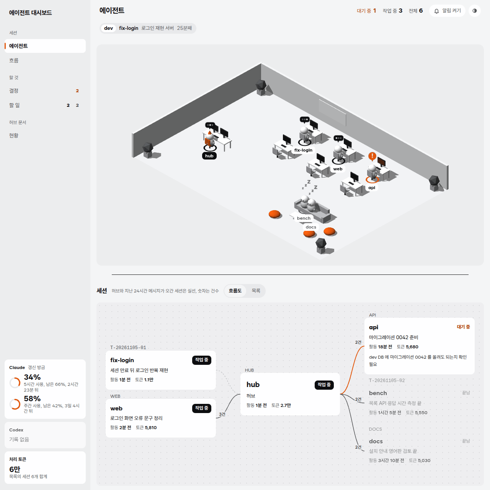
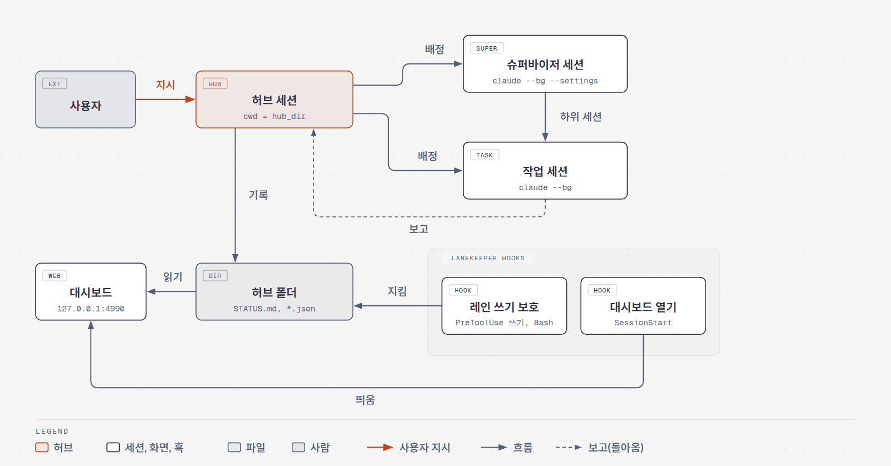
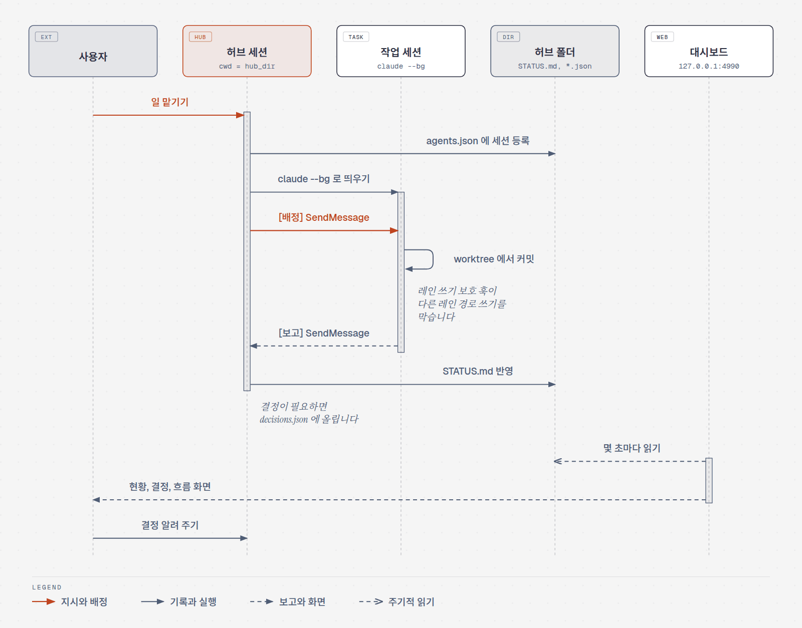
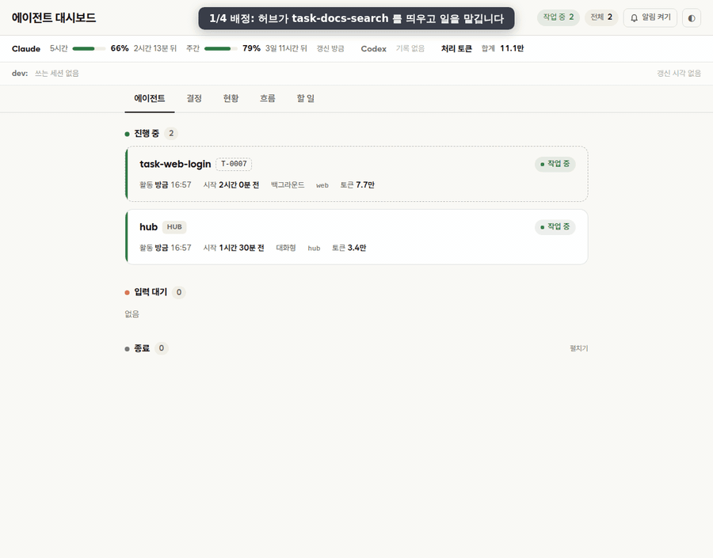
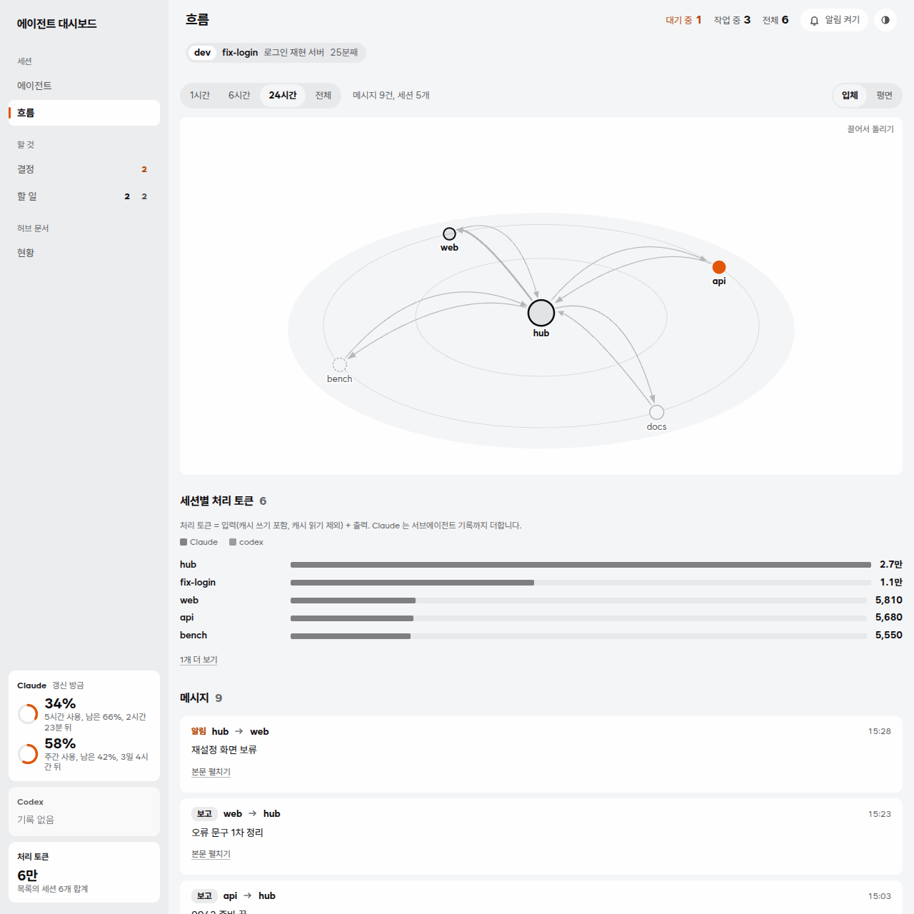

# lanekeeper

[English](README.md) | 한국어

Claude Code 세션 하나를 허브로 두고, 허브가 다른 세션들에 일을 나눠 맡기고 보고를 받아 기록하게 만드는 플러그인입니다. 허브가 따를 규칙 문서 틀과 세션 현황을 보는 로컬 대시보드, 세션이 자기 레인 밖에 쓰지 못하게 막는 훅이 함께 들어 있습니다.

<picture>
  <source media="(prefers-color-scheme: dark)" srcset="docs/images/dashboard-dark.png">
  
</picture>

<picture>
  <source media="(prefers-color-scheme: dark)" srcset="docs/images/ko/architecture-dark.png">
  
</picture>

## 무엇이 들어 있나

| 구성 | 위치 | 하는 일 |
|---|---|---|
| 허브 규칙 틀 | `templates/hub/` | 허브의 역할과 스킬 쓰는 때(`CLAUDE.md`), 세션 사이 약속과 보고 형식(`COORDINATION.md`), 현황판(`STATUS.md`)과 빈 데이터 파일 셋 |
| 대시보드 | `dashboard/` | 떠 있는 세션, 사용자 결정, 현황, 세션 사이 메시지를 보여 주는 읽기 전용 웹 화면. Python 표준 라이브러리만 씁니다 |
| 훅 | `hooks/` | 허브 폴더에서 세션을 열면 대시보드를 띄우고, 세션이 허브 폴더나 다른 레인 경로에 쓰지 못하게 막습니다 |
| 스킬 | `skills/` | 설치 마무리 `setup`, 새 판 받기와 허브 폴더 맞추기 `update` |
| 설치 스크립트 | `scripts/` | `setup` 스킬이 부르는 `setup_hub.py`(허브 폴더 복사와 설정 합치기), `update` 스킬이 부르는 `update_hub.py`(허브 폴더를 새 틀에 맞추기) |
| 설정 예시 | `examples/` | 허브와 슈퍼바이저 세션의 권한, 기본 모델 같은 설정 견본 |

## 배정에서 보고까지

사용자는 기본으로 허브에게 말합니다. 허브는 작업 세션을 띄워 `[배정]` 메시지를 보내고, 작업 세션은 일을 마치면 `[보고]` 를 보냅니다. 허브가 그 결과를 `STATUS.md` 에 적고 사용자 결정이 필요한 것은 `decisions.json` 에 모으면, 사용자는 대시보드에서 한 번에 확인합니다. 시안 다듬기처럼 사용자와 여러 번 주고받을 일은 사용자가 그 작업 세션에 직접 들어가(`claude attach <이름>`) 이야기하고, 작업 세션은 그때 정한 것을 보고에 적습니다.

<picture>
  <source media="(prefers-color-scheme: dark)" srcset="docs/images/ko/flow-dark.png">
  
</picture>

## 빠른 시작

Claude Code 와 Python 3.8 이상이 있으면 됩니다.
Windows, Linux, macOS 모두 같은 방법입니다.

터미널(Windows 는 PowerShell)에서 GitHub 마켓플레이스로 플러그인을 설치합니다.

```sh
claude plugin install lanekeeper --marketplace holiday0726/lanekeeper
```

설치가 끝나면 설정값 `python` 과 `hub_dir` 가 비어 있다는 안내가 나옵니다.
다음 단계에서 채웁니다.

아무 폴더에서 `claude` 를 열고 설치 스킬을 부릅니다.

```
/lanekeeper:setup
```

스킬은 이 순서로 진행합니다.
다시 불러도 결과가 같습니다.

1. Python 3.8 이상을 찾습니다.
   Windows 는 `py -3` 을 먼저 보고, 없으면 `python` 을 봅니다.
   훅이 셸 없이 실행하므로 Windows 에서는 `python.exe` 절대 경로를 설정값으로 씁니다.
2. 허브 폴더를 묻습니다.
   기본값은 홈 폴더 아래 `hub` 입니다.
   `/lanekeeper:setup C:/Users/<나>/hub` 처럼 바로 줘도 됩니다.
3. 허브 폴더를 만들고 규칙 틀과 설정 예시를 복사합니다.
   이미 있는 파일은 덮지 않습니다.
4. 사용자 설정(`~/.claude/settings.json`)에 `crossSessionInbound: "accept"` 가 없으면 더합니다(`examples/user.settings.json`).
   모델 같은 다른 설정은 건드리지 않습니다.
   있는 값은 그대로 두고, 쓰기 전에 `settings.json.bak-<시각>` 으로 백업합니다.
5. `agents.json` 에 허브 폴더 경로를 넣고, 플러그인 설정값 `python` 과 `hub_dir` 를 넣습니다.
6. [Addy-skills](https://github.com/holiday0726/Addy-skills) 플러그인이 없으면 설치할지 묻습니다. 기본은 설치하지 않습니다.

스킬이 끝나면 세션을 닫고 허브 폴더에서 새로 엽니다.
설정값은 Claude Code 를 다시 열어야 적용됩니다.

```sh
cd ~/hub
claude
```

세션이 열리면서 `대시보드 http://127.0.0.1:4990 떠 있음` 으로 시작하는 줄이 보이면 브라우저로 그 주소를 엽니다.
다른 PC 의 브라우저로 볼 때는 [다른 PC 에서 보기](#다른-pc-에서-보기)를 따릅니다.
허브 세션 안에서 `/rename hub` 를 입력합니다.
그다음 [허브 폴더 만들기](#허브-폴더-만들기) 의 1, 2, 4, 5, 6 번대로 `<...>` 자리를 채웁니다.

새 판을 받는 법은 [업데이트](#업데이트)에 있습니다.

## 업데이트

허브 세션에서 업데이트 스킬을 부릅니다.

```
/lanekeeper:update
```

스킬은 이 순서로 진행합니다.

1. 새 판을 받고 전 판과 새 판을 알려 줍니다(아래 두 명령). 손으로 설치했으면 그 폴더에서 `git pull` 할지 묻습니다.
2. 허브 폴더를 새 판의 틀과 비교해 미리 보여 주고, CHANGELOG 에서 그사이 바뀐 것을 요약합니다. 이 단계는 아무것도 바꾸지 않습니다.
3. 반영하겠다고 답하면 `<허브 폴더>/.lanekeeper/backup-<시각>/` 에 백업한 뒤 바꿉니다.
   - 규칙 문서(`CLAUDE.md`, `COORDINATION.md`)와 설정(`.claude/settings.json`, `supervisor.settings.json`): 사용자가 고친 줄은 두고 틀이 바뀐 곳만 넣습니다. 같은 곳을 둘 다 고쳤으면 손대지 않고 무엇을 넣을지 제안합니다. 설정 JSON 은 새로 생긴 최상위 키만 더하고 권한 줄 같은 안쪽 값은 보여 주기만 합니다.
   - 현황판, 명단, 결정, dev 점유(`STATUS.md`, `agents.json`, `decisions.json`, `dev-occupancy.json`): 없을 때만 만들고 있는 파일은 건드리지 않습니다.
   - 사용자 설정(`~/.claude/settings.json`): `/lanekeeper:setup` 처럼 없는 키만 더합니다.
4. 되돌리는 명령을 알려 줍니다. `update_hub.py <허브 폴더> --restore <백업 폴더>` 가 허브 폴더를 반영 전으로 돌립니다.

비교 기준은 `/lanekeeper:setup` 이나 지난 업데이트가 `<허브 폴더>/.lanekeeper/base/` 에 남긴 틀 사본입니다.
0.6.0 까지 만든 허브에는 이 사본이 없어서 첫 업데이트는 허브 파일과 새 틀의 차이를 통째로 보여 주고, 무엇을 넣을지 사용자가 고릅니다. 그다음부터는 틀이 바뀐 곳만 보입니다.

0.6.0 에는 이 스킬이 없습니다. 처음 한 번은 터미널에서 새 판을 받고, 세션에서 `/reload-plugins` 를 입력한 뒤 부릅니다.
이 마켓플레이스처럼 GitHub 에서 추가한 마켓플레이스는 Claude Code 의 백그라운드 자동 업데이트가 기본으로 꺼져 있습니다.

```sh
claude plugin marketplace update lanekeeper
claude plugin update lanekeeper@lanekeeper
```

새 판은 Claude Code 를 다시 열 때 올라옵니다. 이미 열려 있는 세션에서는 `/reload-plugins` 를 입력합니다.
백그라운드에서 받게 하려면 세션에서 `/plugin` 을 열고 **Marketplaces** 에서 `lanekeeper` 를 골라 **Enable auto-update** 를 누릅니다. 그러면 세션에서 첫 메시지를 보낸 뒤 10분 안에 확인하고, 새 판을 받으면 플러그인이 바뀌었으니 `/reload-plugins` 로 적용하라는 줄을 보여 줍니다.

이미 떠 있는 대시보드는 옛 판 화면을 계속 보여 줍니다. 훅은 서버가 없을 때만 띄우기 때문입니다. 로그 첫 줄의 pid 로 서버를 끄고([대시보드](#대시보드) 참고) 허브 세션을 다시 엽니다. 0.5.0 부터는 떠 있는 서버가 다른 판이면 세션 시작 메시지가 그렇게 알려 줍니다.

위 두 명령과 자동 업데이트는 `~/.claude/plugins/cache/` 아래 플러그인 사본만 바꿉니다. 아래는 그대로 남습니다.

- 허브 폴더: `/lanekeeper:setup` 이 복사한 규칙 문서와 데이터 파일, `.claude/settings.json`, `supervisor.settings.json`. 새 판의 틀 변경은 `/lanekeeper:update` 에서 반영하겠다고 답할 때만 들어갑니다.
- 사용자 설정(`~/.claude/settings.json`)과 플러그인 이름 아래 저장된 플러그인 설정값(`python`, `hub_dir` 등).
- `~/.claude/plugins/data/lanekeeper-lanekeeper/` 의 대시보드 로그.

받은 폴더로 설치했다면([손으로 설치하기](#손으로-설치하기)) 그 폴더에서 `git pull` 한 뒤 위 두 명령을 돌립니다. `/lanekeeper:update` 는 `git pull` 할지 먼저 묻습니다.

## 옛 이름에서 옮기기

0.3.0 까지 플러그인 이름은 `agent-hub` 였습니다. `claude plugin uninstall agent-hub@agent-hub` 와 `claude plugin marketplace remove agent-hub` 로 지우고, [빠른 시작](#빠른-시작) 대로 설치한 뒤 `/lanekeeper:setup <허브 폴더>` 로 설정값을 다시 넣습니다. 허브 폴더는 그대로 씁니다. 자세한 것은 [CHANGELOG](CHANGELOG.md) 0.4.0 에 있습니다.

## 손으로 설치하기

코드를 고쳐 쓰려면 저장소를 받아 그 폴더를 로컬 마켓플레이스로 붙입니다. 그다음 [빠른 시작](#빠른-시작) 처럼 `/lanekeeper:setup` 을 부르면 `python` 과 `hub_dir` 를 채웁니다.

```sh
git clone https://github.com/holiday0726/lanekeeper.git ~/lanekeeper
claude plugin marketplace add ~/lanekeeper      # Windows: C:/Users/<나>/lanekeeper
claude plugin install lanekeeper@lanekeeper
claude plugin details lanekeeper@lanekeeper     # Skills (2), Hooks (2) 가 보이면 설치된 것
```

마켓플레이스가 그 폴더를 가리키니 옮기지 않습니다. 플러그인은 설치할 때 `~/.claude/plugins/cache/` 로 복사한 사본으로 돌아가므로, 새 판은 그 폴더에서 `git pull` 한 뒤 [업데이트](#업데이트)의 두 명령이나 `/lanekeeper:update` 로 받습니다. 인터넷이 없는 PC 에는 `git bundle create ../lanekeeper.bundle HEAD main` 으로 만든 묶음을 옮겨 clone 합니다.

## Addy-skills (선택)

허브 규칙 틀 `CLAUDE.md` 의 "스킬 쓰는 때" 절은 [Addy-skills](https://github.com/holiday0726/Addy-skills) 플러그인의 스킬을 부릅니다. 배정과 보고를 감독하는 스킬 일곱 개(`addy-skills:agent-oversight` 와 그 아래 스킬), 글을 다듬는 `humanizer`, 커밋 문구 규칙 `git-message`(선택으로 켜는 git 문구 검사 훅 포함)입니다. 뒤의 둘은 0.5.1 까지 lanekeeper 에 있었습니다. 설치하지 않으면 허브가 그 절을 건너뜁니다.

```sh
claude plugin install addy-skills --marketplace holiday0726/Addy-skills
```

## 설정값

앞의 둘은 `/lanekeeper:setup` 이 채웁니다. 바꿀 때는 `claude plugin configure lanekeeper@lanekeeper` 나 세션 안 `/plugin configure lanekeeper@lanekeeper` 를 씁니다.

| 키 | 필수 | 뜻 | 기본값 |
|---|---|---|---|
| `python` | 예 | 훅을 돌릴 Python 3 명령. Linux 와 macOS 는 `python3`, Windows 는 `/` 로 쓴 `python.exe` 절대 경로(훅이 셸 없이 실행) | 없음 |
| `hub_dir` | 예 | 허브 폴더의 절대 경로. Windows 는 `C:/Users/<나>/hub` 처럼 `/` 로 씁니다 | 없음 |
| `dashboard_port` | 아니오 | 대시보드 포트. 주소는 늘 `127.0.0.1` 입니다 | `4990` |
| `orca` | 아니오 | 허브 세션을 열 때 Orca 브라우저 탭으로 대시보드를 열지 | 켬(`orca` 명령이 있을 때만) |
| `lane_message_hub_only` | 아니오 | 워커가 허브에게만 `SendMessage` 하게 할지([훅](#훅)) | 꺼짐 |

## 허브 폴더 만들기

허브 폴더는 허브 세션을 여는 폴더이고, 설정값 `hub_dir` 와 같은 경로여야 합니다. 규칙 틀과 설정 예시를 복사합니다.
`/lanekeeper:setup` 을 썼다면 아래 복사와 3, 4 번은 이미 되어 있습니다.

Linux, macOS:

```sh
mkdir -p ~/hub/.claude
cp ~/lanekeeper/templates/hub/* ~/hub/
cp ~/lanekeeper/examples/hub.settings.json ~/hub/.claude/settings.json
cp ~/lanekeeper/examples/supervisor.settings.json ~/hub/supervisor.settings.json
```

Windows PowerShell:

```powershell
$hub = "C:\Users\<나>\hub"; $src = "C:\Users\<나>\lanekeeper"
New-Item -ItemType Directory -Force "$hub\.claude" | Out-Null
Copy-Item "$src\templates\hub\*" $hub
Copy-Item "$src\examples\hub.settings.json" "$hub\.claude\settings.json"
Copy-Item "$src\examples\supervisor.settings.json" "$hub\supervisor.settings.json"
```

복사한 뒤 프로젝트에 맞게 채웁니다. 권한과 기본 모델은 플러그인이 넣어 줄 수 없어서 이렇게 예시 파일로 둡니다.

1. `.claude/settings.json`: 허브 세션의 모델과 권한입니다. `deny` 의 `<레인 저장소>` 자리에 허브가 직접 고치면 안 되는 저장소를, `additionalDirectories` 에 그 저장소들의 상위 폴더를 넣습니다.
2. `supervisor.settings.json`: 허브가 슈퍼바이저 세션을 띄울 때 `--settings` 로 붙이는 파일입니다. 슈퍼바이저에게 허락할 일을 `autoMode.allow` 에 문장으로 적습니다.
3. 사용자 설정(`~/.claude/settings.json`, Windows 는 `%USERPROFILE%\.claude\settings.json`)에 `examples/user.settings.json` 의 키를 손으로 합칩니다. `crossSessionInbound: "accept"` 가 있어야 세션 사이 메시지가 승인 대기 없이 바로 전달됩니다.
4. `agents.json` 의 `resident.hub.cwd` 에 허브 폴더 경로를 넣고, 허브 세션 안에서 `/rename hub` 로 이름을 맞춥니다. 대시보드는 이 파일에서 `lane` 이 `HUB` 인 세션을 허브로 봅니다. `lanes` 에는 레인마다 소유 경로를 적습니다(예: `"WEB": ["~/projects/web"]`). 레인 쓰기 보호 훅이 이것을 읽습니다. `python3 ~/lanekeeper/scripts/lane_deny.py ~/hub` 가 1단계 `deny` 에 넣을 줄을 찍어 줍니다.
5. `CLAUDE.md` 와 `COORDINATION.md` 의 `<...>` 자리에 레인, 저장소, 인터페이스를 적습니다.
6. `CLAUDE.md` 에서 두 가지를 정합니다. "세션 다루기" 의 동시 작업 세션 상한(기본 8개)은 사용하는 PC 와 요금제에 맞게 바꿉니다. "하지 않는 것" 의 병합 위임은 선택입니다. 쓰지 않으면 그 줄을 지우고, 쓰면 허락 여부와 예외 저장소를 그 아래에 적습니다.

## 대시보드

허브 폴더의 `agents.json`, `decisions.json`, `STATUS.md`, `dev-occupancy.json` 과 `~/.claude` 아래 세션 기록을 몇 초마다 읽어 보여 줍니다. 읽기만 하고, 세션에 입력을 보내거나 멈추지 않습니다.



<picture>
  <source media="(prefers-color-scheme: dark)" srcset="docs/images/dashboard-flow-dark.png">
  
</picture>

화면의 세션과 데이터는 설명용 견본입니다.

| 탭 | 보여 주는 것 |
|---|---|
| 에이전트 | 허브를 가운데 둔 흐름도나 카드 목록이고, 세션을 누르면 대화 기록과 `claude logs` 화면이 나옵니다. `3D 오피스` 단추로 켜면(선택, 그때 three.js 를 불러옴) 위에 아이소메트릭 오피스가 나옵니다. 세션마다 책상이 있고, 작업 중이면 앉아서 일하고, 사용자를 기다리면 오렌지 `!` 를 띄우고, 쉬면 라운지로 걸어갑니다. 배정과 보고 서류가 허브와 책상 사이를 날아갑니다. 오피스 아래 구분선을 끌거나 화살표 키로 오피스 높이를 바꾸고, 끝까지 올리면 접힙니다. WebGL 이 없으면 오피스와 구분선은 숨습니다. 다른 세션이 `claude --bg` 로 띄운 세션(예: 슈퍼바이저가 띄운 세션)은 흐름도에서 띄운 세션 아래에 들어가고, 목록 카드에는 상위 세션이 붙습니다. 띄운 세션의 기록에 남은 `claude --bg` 결과로 정하고 추정하지 않습니다 |
| 결정 | `decisions.json` 의 결정 항목과 지금 사용자 입력을 기다리는 세션 |
| 현황 | `STATUS.md` |
| 흐름 | 세션 사이 `SendMessage` 를 그래프와 목록으로. 그래프는 기본이 기울어진 입체이고(끌거나 화살표 키로 돌림) 평면으로 바꿀 수 있습니다. `[배정]`, `[보고]`, `[알림]` 머리말로 종류를 나눕니다 |
| 할 일 | 세션별 할 일 목록 |

창 폭이 1000px 이상이면 탭이 왼쪽 사이드바로 가고 남은 사용량 링은 그 아래 칸에 놓입니다.

허브 폴더에서 세션을 열면 훅이 대시보드를 띄워 주므로 따로 실행할 일은 없습니다. 손으로 띄울 때는 허브 폴더와 포트를 환경변수로 줍니다.

```sh
HUB_DIR=~/hub PORT=4990 python3 ~/lanekeeper/dashboard/server.py
```

```powershell
$env:HUB_DIR = "C:\Users\<나>\hub"; $env:PORT = "4990"; py -3 C:\Users\<나>\lanekeeper\dashboard\server.py
```

훅이 띄운 서버의 로그는 `~/.claude/plugins/data/lanekeeper-lanekeeper/dashboard-<포트>.log` 에 남고, 첫 줄에 서버 pid 가 있습니다. 끌 때는 그 pid 로 `kill <pid>`(Windows 는 `Stop-Process -Id <pid>`)를 실행합니다. 화면 하나하나의 설명은 [dashboard/README.md](dashboard/README.md) 에 있습니다.

### 다른 PC 에서 보기

대시보드는 `127.0.0.1` 에만 묶여 있어 Claude Code 가 도는 컴퓨터에서만 열립니다. 다른 PC 의 브라우저로 볼 때는 쓰는 클라이언트에 따라 다릅니다.

- 같은 PC: 그대로 `http://127.0.0.1:<포트>` 를 엽니다.
- 포트를 전달해 주는 클라이언트(VS Code 나 Cursor 의 Remote, Orca): 전달된 `http://127.0.0.1:<포트>` 를 엽니다. 대시보드는 `127.0.0.1:<포트>`, `localhost:<포트>` 로 온 요청만 받으므로 PC 쪽 포트도 같은 번호여야 합니다. 다른 번호로 전달되면 `bad host` 가 나옵니다.
- Paseo 처럼 포트를 전달하지 않는 클라이언트: PC 에서 아래 명령을 띄워 둔 채 `http://127.0.0.1:<포트>` 를 엽니다. Windows PowerShell 에서도 같은 명령이고, 포트를 바꿨다면 두 4990 을 그 번호로 바꿉니다. PC 에서 그 호스트로 SSH 접속이 되어야 하고, 창을 닫으면 끊깁니다.

  ```sh
  ssh -N -L 4990:127.0.0.1:4990 <사용자>@<호스트>
  ```

`0.0.0.0` 으로 열거나 공개 터널 서비스에 올리지 않습니다. 주소에 닿는 누구나 세션 대화 기록과 로그를 읽을 수 있습니다. 같은 PC 에 다른 계정이 들어온다면 허브 세션을 열기 전에 환경 변수 `LANEKEEPER_TOKEN` 에 긴 임의 값을 넣습니다. 그러면 서버는 `http://127.0.0.1:<포트>/?token=<값>` 을 한 번 연 브라우저(쿠키로 기억)에만 답하고, 세션 시작 메시지가 그 주소를 알려 줍니다.

## 훅

`hooks/hooks.json` 은 셸을 거치지 않는 형식이라 Windows 에서 Git Bash 를 쓰든 PowerShell 을 쓰든 똑같이 돕니다. 훅 스크립트는 모두 Python 입니다.

| 훅 | 언제 | 하는 일 |
|---|---|---|
| 대시보드 열기 (`open_dashboard.py`) | 세션 시작(SessionStart) | 프로젝트 폴더가 `hub_dir` 이거나 그 아래일 때만 동작합니다. 대시보드가 꺼져 있으면 띄우고, `orca` 가 켜져 있으면 Orca 탭으로 엽니다. 떠 있는 서버가 다른 판이면 끄라고 알립니다([업데이트](#업데이트)) |
| 레인 쓰기 보호 (`lane_guard.py`) | Edit, Write, NotebookEdit, Bash, SendMessage 직전 | 허브 폴더는 허브, 허브 `agents.json` 의 `lanes` 에 적은 경로는 그 레인의 것입니다. 세션은 연 폴더로 레인이 정해지고(`<저장소>/.claude/worktrees/` 아래 worktree 는 그 저장소 레인) 자기 레인에만 씁니다. 다른 곳에 쓰려 하면 막고 허브에 요청하라고 알립니다. Windows 경로는 대소문자와 역슬래시, `/c/` 꼴을 같은 경로로 봅니다. Bash 는 리다이렉트(`>`, `>>`), `tee`, `sed -i`, `cp`, `mv` 만 최선으로 봅니다. 변수, 스크립트, 다른 명령은 지나가니 실수를 막는 장치이지 보안 경계가 아닙니다. 설정 `lane_message_hub_only` 를 켜면 워커는 허브에게만 `SendMessage` 합니다 |

## 스킬

| 스킬 | 부르는 법 | 쓰임 |
|---|---|---|
| setup | `/lanekeeper:setup [허브 폴더]` | 설치를 마무리합니다. 허브 폴더를 만들고 사용자 설정과 플러그인 설정값을 채웁니다. [빠른 시작](#빠른-시작) 참고 |
| update | `/lanekeeper:update [허브 폴더]` | 새 판을 받고 허브 폴더를 새 틀에 맞춥니다. 미리 보기가 기본이고 확인 뒤 백업하고 반영합니다. [업데이트](#업데이트) 참고 |

## 저장소 구조

```
.claude-plugin/   plugin.json, marketplace.json
dashboard/        server.py, index.html, app.css, js/, test_server.py, vendor/
docs/             README 그림(images/en, images/ko)과 그림 원본(diagrams/en, diagrams/ko)
examples/         hub.settings.json, supervisor.settings.json, user.settings.json
hooks/            hooks.json, open_dashboard.py, lane_guard.py, hubpath.py
scripts/          setup_hub.py, update_hub.py, lane_deny.py
skills/           setup/, update/
templates/hub/    CLAUDE.md, COORDINATION.md, STATUS.md, agents.json, decisions.json, dev-occupancy.json
tests/            훅과 설치, 업데이트 스크립트 시험
```

## 시험 돌리기

```sh
python3 -m pip install pytest
python3 -m pytest -q                    # 훅, 설치와 업데이트 스크립트, 대시보드 서버(tests/, dashboard/)
claude plugin validate --strict .       # 매니페스트 검사
```

Windows 에서는 `python3` 자리에 `py -3` 을 씁니다. 훅 시험은 Windows 한국어 로캘과 같은 조건(표준 입출력 기본값 cp949)으로 돌아갑니다. GitHub Actions 가 push 마다 Linux 와 Windows 에서 같은 시험을 돌립니다([.github/workflows/test.yml](.github/workflows/test.yml)).

## 라이선스와 출처

MIT 라이선스입니다([LICENSE](LICENSE)). 함께 넣은 것은 각자의 라이선스를 따릅니다.

- `dashboard/vendor/three.min.js`, `OrbitControls.js`: [three.js](https://github.com/mrdoob/three.js) r128(npm 0.128.0, 고치지 않음), MIT, `dashboard/vendor/three-LICENSE`
- `dashboard/vendor/xterm.js`, `xterm.css`: [xterm.js](https://github.com/xtermjs/xterm.js) 5.5.0, MIT, `dashboard/vendor/xterm-LICENSE`
- `dashboard/vendor/WantedSansVariable.woff2`: [Wanted Sans](https://github.com/wanteddev/wanted-sans) 1.0.3, SIL OFL 1.1, `dashboard/vendor/WantedSans-OFL.txt`

README 의 구성도와 순서도는 diagram-design 으로 그렸고, 언어별 원본은 `docs/diagrams/ko/` 와 `docs/diagrams/en/` 에 있습니다.
