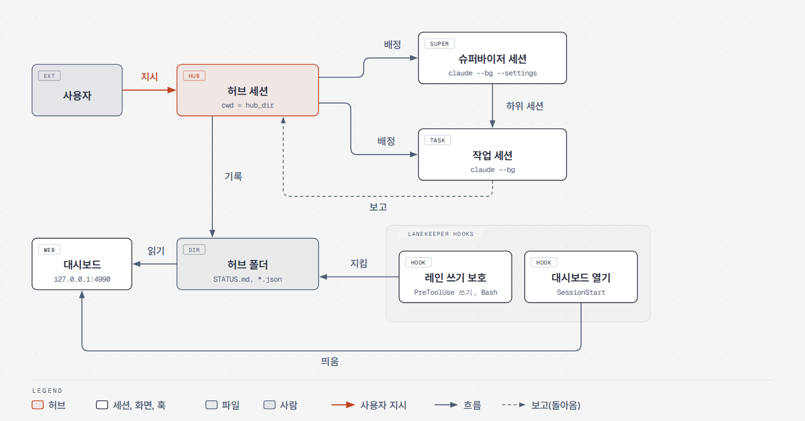

# lanekeeper

English | [한국어](README.ko.md)

A plugin that makes one Claude Code session the hub. The hub splits work across other sessions, hands it out, receives their reports and keeps the record. It ships with rule document templates for the hub, a local dashboard that shows what the sessions are doing, and hooks that protect the hub folder.

<picture>
  <source media="(prefers-color-scheme: dark)" srcset="docs/images/dashboard-dark.png">
  
</picture>

<picture>
  <source media="(prefers-color-scheme: dark)" srcset="docs/images/architecture-dark.png">
  
</picture>

The diagrams and the dashboard screenshots use Korean labels.

## What is in it

| Part | Where | What it does |
|---|---|---|
| Hub rule templates | `templates/hub/` | The hub role and when to use which skill (`CLAUDE.md`), agreements between sessions and the report format (`COORDINATION.md`), a status board (`STATUS.md`) and three empty data files |
| Dashboard | `dashboard/` | A web page that only reads. It shows running sessions, user decisions, status and messages between sessions. It uses only the Python standard library |
| Hooks | `hooks/` | Start the dashboard when a session opens in the hub folder, stop other sessions from editing the hub folder, and check git commit messages when you turn that on |
| Skills | `skills/` | `setup` to finish the install, `humanizer` to make text read like a person wrote it, `git-message` with the commit message rules |
| Install script | `scripts/` | `setup_hub.py`, called by the `setup` skill. It copies the hub folder and merges settings |
| Settings examples | `examples/` | Sample settings for the hub and supervisor sessions, such as permissions and the default model |

## From assignment to report

The user talks only to the hub. The hub starts a task session and sends it an `[배정]` (assignment) message. When the task session is done it sends back a `[보고]` (report). The hub writes the result to `STATUS.md` and collects anything that needs a user decision in `decisions.json`, so the user can check it all at once on the dashboard.

<picture>
  <source media="(prefers-color-scheme: dark)" srcset="docs/images/flow-dark.png">
  
</picture>

## Quick start

You need Claude Code and Python 3.8 or later.
The steps are the same on Windows, Linux and macOS.

The hub rule templates (`templates/hub`) and the skill documents are written in Korean. The hub session reads them as they are, so the hub follows Korean rules and writes Korean messages unless you translate the templates.

In a terminal (PowerShell on Windows), install the plugin from the GitHub marketplace.

```sh
claude plugin install lanekeeper --marketplace holiday0726/lanekeeper
```

When the install finishes you will see a note that the settings `python` and `hub_dir` are empty.
The next step fills them in.

Open `claude` in any folder and call the setup skill.

```
/lanekeeper:setup
```

The skill goes through these steps.
Running it again gives the same result.

1. Finds Python 3.8 or later.
   On Windows it tries `py -3` first, then `python`.
   Hooks run without a shell, so on Windows the setting is the absolute path to `python.exe`.
2. Asks for the hub folder.
   The default is `hub` under your home folder.
   You can also pass it directly, as in `/lanekeeper:setup C:/Users/<you>/hub`.
3. Creates the hub folder and copies the rule templates and settings examples.
   Files that already exist are not overwritten.
4. Adds `crossSessionInbound: "accept"` to your user settings (`~/.claude/settings.json`) if it is missing (`examples/user.settings.json`).
   Other settings such as the model are left alone.
   Existing values stay, and the file is backed up to `settings.json.bak-<time>` before writing.
5. Puts the hub folder path into `agents.json`, and sets the plugin settings `python` and `hub_dir`.
6. Asks whether to install the [Addy-skills](https://github.com/holiday0726/Addy-skills) plugin if it is missing. The default is not to install it.

When the skill is done, close the session and open a new one in the hub folder.
Settings take effect only after Claude Code is opened again.

```sh
cd ~/hub
claude
```

When the session opens and shows a line starting with `대시보드 http://127.0.0.1:4990 떠 있음` (dashboard is up), open that address in a browser.
To view it from a browser on another PC, see [Viewing from another PC](#viewing-from-another-pc). The hook message points to the Korean heading of the same section, "다른 PC 에서 보기".
In the hub session, type `/rename hub`.
Then fill in the `<...>` spots as in steps 1, 2 and 5 of [Set up the hub folder](#set-up-the-hub-folder).

To get a new version, see [Updating](#updating).

## Updating

For a marketplace added from GitHub, like this one, Claude Code's background auto-update is off by default, so get a new version in a terminal.

```sh
claude plugin marketplace update lanekeeper
claude plugin update lanekeeper@lanekeeper
```

The new version loads when you start Claude Code again, or after `/reload-plugins` in a session that is already open.
To let Claude Code do this in the background, open `/plugin` in a session, go to **Marketplaces**, select `lanekeeper` and choose **Enable auto-update**. It then checks within ten minutes after your first message in a session and shows a `Plugin updated: … · Run /reload-plugins to apply` line.

A dashboard that is already running keeps showing the old version, because the hook only starts a server when none is running. Stop it with the pid on the first line of its log (see [Dashboard](#dashboard)), then open the hub session again. From 0.5.0 the session start message says so when the running server is from another version. That message points to the Korean heading of this section, "업데이트".

An update replaces only the plugin's own copy under `~/.claude/plugins/cache/`. These stay as they are:

- The hub folder: the rule documents and data files that `/lanekeeper:setup` copied, `.claude/settings.json` and `supervisor.settings.json`. Because setup never overwrites them, changes to `templates/hub/` in a new version do not reach an existing hub folder. When the [CHANGELOG](CHANGELOG.md) mentions a template change, compare your files with `templates/hub/` yourself.
- Your user settings (`~/.claude/settings.json`) and the plugin settings (`python`, `hub_dir` and the rest), which are stored under the plugin name.
- The dashboard logs in `~/.claude/plugins/data/lanekeeper-lanekeeper/`.

If you installed from a cloned folder ([Manual install](#manual-install)), run `git pull` in that folder instead.

## Moving from the old name

Up to 0.3.0 the plugin and the marketplace were called `agent-hub`, and the repository was called `claude-hub-plugin`.
Because the name changed, `claude plugin update` does not carry you over. Remove the old one and install again.

1. Write down the old settings.
   The `inputs` field in the output of `claude plugin configure agent-hub@agent-hub --json` holds values such as `python` and `hub_dir`.
2. Remove the old plugin and marketplace.

   ```sh
   claude plugin uninstall agent-hub@agent-hub
   claude plugin marketplace remove agent-hub
   ```

3. Install `lanekeeper` as in [Quick start](#quick-start) or [Manual install](#manual-install).
4. Enter the settings again.
   Settings are stored per plugin name under `pluginConfigs` in `~/.claude/settings.json`, and they are deleted together with the old plugin.
   Call `/lanekeeper:setup <hub folder>` or use `claude plugin configure lanekeeper@lanekeeper` to enter the values from step 1.
   The files in the hub folder stay as they are.
5. From 0.4.0 the git message check hook is off by default.
   To keep using it, set `git_message_check` to `true` ([Settings](#settings)).

The data folder also changes from `~/.claude/plugins/data/agent-hub-agent-hub/` to `~/.claude/plugins/data/lanekeeper-lanekeeper/`.
The old folder holds only dashboard logs, so you can delete it.
If you cloned the repository and installed by hand, change the remote of that folder to `https://github.com/holiday0726/lanekeeper.git` (`git remote set-url origin <url>`).
GitHub also forwards the old address to the new one.

## Manual install

Use this if you do not use the setup skill, or if you want to clone the repository and change it.

You need Claude Code, git and Python 3.8 or later. The repository folder is itself a local marketplace, so you add the cloned folder as a marketplace and install the `lanekeeper` plugin in it.

### Windows

Hooks run the `python` setting directly, without a shell. So on Windows you give the absolute path to `python.exe`. Check the path in PowerShell.

```powershell
py -3 -c "import sys; print(sys.executable)"
# without the py launcher: python -c "import sys; print(sys.executable)"
```

Change the backslashes in the printed path to `/` and use it in the install. If the path has spaces, quote it like `"python=C:/Program Files/Python312/python.exe"`.

```powershell
cd $HOME
git clone https://github.com/holiday0726/lanekeeper.git
claude plugin marketplace add C:/Users/<you>/lanekeeper
claude plugin install lanekeeper@lanekeeper `
  --config python=C:/Users/<you>/AppData/Local/Programs/Python/Python312/python.exe `
  --config hub_dir=C:/Users/<you>/hub
```

You can also install inside a Claude Code session. Type `/plugin marketplace add C:/Users/<you>/lanekeeper` and `/plugin install lanekeeper@lanekeeper`, then fill in `python` and `hub_dir` in the `/plugin configure lanekeeper@lanekeeper` dialog.

### Linux, macOS

```sh
git clone https://github.com/holiday0726/lanekeeper.git ~/lanekeeper
claude plugin marketplace add ~/lanekeeper
claude plugin install lanekeeper@lanekeeper --config python=python3 --config hub_dir="$HOME/hub"
```

### Plugin to use with it (optional)

The "스킬 쓰는 때" (when to use skills) section of the hub template `CLAUDE.md` calls skills from the [Addy-skills](https://github.com/holiday0726/Addy-skills) plugin.
These are seven skills that oversee assignments and reports (`addy-skills:agent-oversight` and the skills under it).
The four principles in `STATUS.md` and the report format in `COORDINATION.md` also follow these skills.
Installing it is optional. Without it, the hub skips that section.

```sh
claude plugin install addy-skills --marketplace holiday0726/Addy-skills
```

Inside a Claude Code session, type this.

```
/plugin install addy-skills --marketplace holiday0726/Addy-skills
```

If `claude plugin details addy-skills@addy-skills` lists seven skills, it is installed.

### Check the install and update

```sh
claude plugin details lanekeeper@lanekeeper    # installed if it shows Skills (3), Hooks (2)
```

The plugin reads the cloned folder in place. Do not move or delete that folder after installing. To get a new version, run `git pull` in that folder and open the session again, or type `/reload-plugins` in the session.

For a PC without internet access, pack it somewhere else and carry it over.

```sh
cd lanekeeper
git bundle create ../lanekeeper.bundle HEAD main      # receiving side: git clone lanekeeper.bundle lanekeeper
git archive --format=zip -o ../lanekeeper.zip main    # receiving side: just unzip it
```

### Settings

Pass them with `--config key=value` when installing, and change them later with `claude plugin configure lanekeeper@lanekeeper` or `/plugin configure lanekeeper@lanekeeper` inside a session.

| Key | Required | Meaning | Default |
|---|---|---|---|
| `python` | Yes | Python 3 command that runs the hooks. `python3` on Linux and macOS, the absolute path to `python.exe` on Windows | none |
| `hub_dir` | Yes | Absolute path to the hub folder. On Windows write it with `/`, as in `C:/Users/<you>/hub` | none |
| `dashboard_port` | No | Dashboard port. The address is always `127.0.0.1` | `4990` |
| `orca` | No | Whether to open the dashboard in an Orca browser tab when the hub session opens | on (only if the `orca` command exists) |
| `git_message_check` | No | Whether to turn on the git message check hook. To turn it on, add `--config git_message_check=true` to `claude plugin install`, or set `true` with `claude plugin configure lanekeeper@lanekeeper` | off |

## Set up the hub folder

The hub folder is where you open the hub session, and it must be the same path as the `hub_dir` setting. Copy the rule templates and settings examples into it.
If you used `/lanekeeper:setup`, the copy below and steps 3 and 4 are already done.

Linux, macOS:

```sh
mkdir -p ~/hub/.claude
cp ~/lanekeeper/templates/hub/* ~/hub/
cp ~/lanekeeper/examples/hub.settings.json ~/hub/.claude/settings.json
cp ~/lanekeeper/examples/supervisor.settings.json ~/hub/supervisor.settings.json
```

Windows PowerShell:

```powershell
$hub = "C:\Users\<you>\hub"; $src = "C:\Users\<you>\lanekeeper"
New-Item -ItemType Directory -Force "$hub\.claude" | Out-Null
Copy-Item "$src\templates\hub\*" $hub
Copy-Item "$src\examples\hub.settings.json" "$hub\.claude\settings.json"
Copy-Item "$src\examples\supervisor.settings.json" "$hub\supervisor.settings.json"
```

After copying, fill them in for your project. A plugin cannot set permissions or the default model, so they come as example files.

1. `.claude/settings.json`: model and permissions of the hub session. Put the repositories the hub must not edit directly into the `<레인 저장소>` (lane repository) spot under `deny`, and their parent folders into `additionalDirectories`.
2. `supervisor.settings.json`: the file the hub attaches with `--settings` when it starts a supervisor session. Write what the supervisor is allowed to do as sentences in `autoMode.allow`.
3. Merge the keys of `examples/user.settings.json` into your user settings (`~/.claude/settings.json`, on Windows `%USERPROFILE%\.claude\settings.json`) by hand. `crossSessionInbound: "accept"` lets messages between sessions arrive without waiting for approval.
4. Put the hub folder path into `resident.hub.cwd` in `agents.json`, and match the name with `/rename hub` inside the hub session. The dashboard treats the session whose `lane` is `HUB` in this file as the hub.
5. Fill in lanes, repositories and interfaces at the `<...>` spots in `CLAUDE.md` and `COORDINATION.md`.

## Dashboard

Every few seconds it reads `agents.json`, `decisions.json`, `STATUS.md` and `dev-occupancy.json` in the hub folder, plus the session records under `~/.claude`, and shows them. It only reads. It does not send input to sessions or stop them.


<picture>
  <source media="(prefers-color-scheme: dark)" srcset="docs/images/dashboard-flow-dark.png">
  
</picture>

The sessions and data on screen are samples for illustration.

| Tab | What it shows |
|---|---|
| 에이전트 (Agents) | An isometric 3D office at the top. Each session has a desk: it sits and types while it works, shows an orange `!` when it waits for you, and walks to the lounge when it rests. Assignment and report sheets fly between the hub and the desks. Drag to turn the room, click a person to open that session. Below it, a flow chart of the sessions around the hub, or the card list. Click a session to see its conversation and the `claude logs` view. Without WebGL only the flow chart shows |
| 결정 (Decisions) | Decision items from `decisions.json` and sessions waiting for user input right now |
| 현황 (Status) | `STATUS.md` |
| 흐름 (Flow) | `SendMessage` between sessions as a graph and a list. The graph is tilted 3D by default (drag or arrow keys to turn it) and can be switched to flat. The prefixes `[배정]`, `[보고]` and `[알림]` tell the kinds apart |
| 할 일 (To do) | To do list per session |

When the window is 1000px or wider, the tabs move to a sidebar on the left and the usage rings sit at its foot.

When you open a session in the hub folder, the hook starts the dashboard for you, so there is nothing else to run. To start it by hand, pass the hub folder and port as environment variables.

```sh
HUB_DIR=~/hub PORT=4990 python3 ~/lanekeeper/dashboard/server.py
```

```powershell
$env:HUB_DIR = "C:\Users\<you>\hub"; $env:PORT = "4990"; py -3 C:\Users\<you>\lanekeeper\dashboard\server.py
```

The log of a server started by the hook is at `~/.claude/plugins/data/lanekeeper-lanekeeper/dashboard-<port>.log`, and its first line has the server pid. To stop it, run `kill <pid>` (on Windows `Stop-Process -Id <pid>`). Each screen is described in [dashboard/README.md](dashboard/README.md) (Korean).

### Viewing from another PC

The dashboard listens only on `127.0.0.1`, so it opens only on the computer where Claude Code runs. To view it in a browser on another PC, it depends on your client.

- Same PC: open `http://127.0.0.1:<port>` as is.
- A client that forwards ports (VS Code or Cursor Remote, Orca): open the forwarded `http://127.0.0.1:<port>`. The dashboard answers only requests addressed to `127.0.0.1:<port>` or `localhost:<port>`, so the port on your PC must be the same number. If it is forwarded to a different number you get `bad host`.
- A client that does not forward ports, such as Paseo: keep the command below running on your PC and open `http://127.0.0.1:<port>`. The same command works in Windows PowerShell. If you changed the port, replace both 4990s with it. Your PC must be able to SSH to that host, and closing the window ends the tunnel.

  ```sh
  ssh -N -L 4990:127.0.0.1:4990 <user>@<host>
  ```

Do not bind it to `0.0.0.0` or put it behind a public tunnel service. The dashboard has no login, so anyone who can reach the address can read session conversations and logs.

## Hooks

`hooks/hooks.json` uses the form that does not go through a shell, so it works the same on Windows with Git Bash or PowerShell. All hook scripts are Python.

| Hook | When | What it does |
|---|---|---|
| Open dashboard (`open_dashboard.py`) | Session start (SessionStart) | Acts only when the project folder is `hub_dir` or inside it. Starts the dashboard if it is not running, and opens it in an Orca tab if `orca` is on. If the running server is from another version, it says to stop it ([Updating](#updating)) |
| Protect hub folder (`hub_only_write.py`) | Before Edit, Write, NotebookEdit | Blocks a session opened outside the hub folder from editing files in the hub folder, and tells it to report to the hub. Windows paths with different case, backslashes or the `/c/` form count as the same path |
| Git message check (`git-message-style.py`) | Before Bash and PowerShell commands | Blocks `git commit`, `merge`, `tag`, `revert` and `gh pr create`, `edit` when the message breaks the bullet style rules. Off by default; set `git_message_check` to `true` to turn it on. Once on, set the environment variable `CLAUDE_GIT_STYLE=off` to pause it |

## Skills

| Skill | How to call | Use |
|---|---|---|
| setup | `/lanekeeper:setup [hub folder]` | Finishes the install. Creates the hub folder and fills in user settings and plugin settings. See [Quick start](#quick-start) |
| humanizer | `/lanekeeper:humanizer` | Fixes text that reads as written by AI. Used to polish the hub's `STATUS.md` and decision text |
| git-message | `/lanekeeper:git-message` | Rules for writing commit, merge and PR messages as bullets. Read it together with the git message check hook when the hook blocks you |

## Repository layout

```
.claude-plugin/   plugin.json, marketplace.json
dashboard/        server.py, index.html, test_server.py, vendor/
docs/             README images (images/) and their sources (diagrams/)
examples/         hub.settings.json, supervisor.settings.json, user.settings.json
hooks/            hooks.json, open_dashboard.py, hub_only_write.py, git-message-style.py, hubpath.py
scripts/          setup_hub.py
skills/           setup/, humanizer/, git-message/
templates/hub/    CLAUDE.md, COORDINATION.md, STATUS.md, agents.json, decisions.json, dev-occupancy.json
tests/            tests for the hooks and the install script
```

## Running the tests

```sh
python3 dashboard/test_server.py        # dashboard server
python3 tests/test_hub_only_write.py    # hub folder protection, including Windows path forms
python3 tests/test_style_basic.py       # git message basic rules and the on/off setting
python3 tests/test_style_multi.py       # several git commands in one call
python3 tests/test_open_dashboard.py    # open dashboard hook, starts a server on a free port and stops it
python3 tests/test_setup_hub.py         # install script, runs only on temp folders and a fake HOME
claude plugin validate --strict .       # manifest check
```

On Windows use `py -3` in place of `python3`. The hook tests run under the same conditions as a Korean Windows locale (standard I/O default cp949).

## License and credits

MIT license ([LICENSE](LICENSE)). Bundled parts follow their own licenses.

- `skills/humanizer`: [blader/humanizer](https://github.com/blader/humanizer), MIT, `skills/humanizer/LICENSE`
- `dashboard/vendor/three.min.js`, `OrbitControls.js`: [three.js](https://github.com/mrdoob/three.js) r128 (npm 0.128.0, unchanged), MIT, `dashboard/vendor/three-LICENSE`
- `dashboard/vendor/xterm.js`, `xterm.css`: [xterm.js](https://github.com/xtermjs/xterm.js) 5.5.0, MIT, `dashboard/vendor/xterm-LICENSE`
- `dashboard/vendor/WantedSansVariable.woff2`: [Wanted Sans](https://github.com/wanteddev/wanted-sans) 1.0.3, SIL OFL 1.1, `dashboard/vendor/WantedSans-OFL.txt`

The architecture diagram was drawn with diagram-design and the sequence diagram with [Archify](https://github.com/tt-a1i/archify). Sources are in `docs/diagrams/`.
