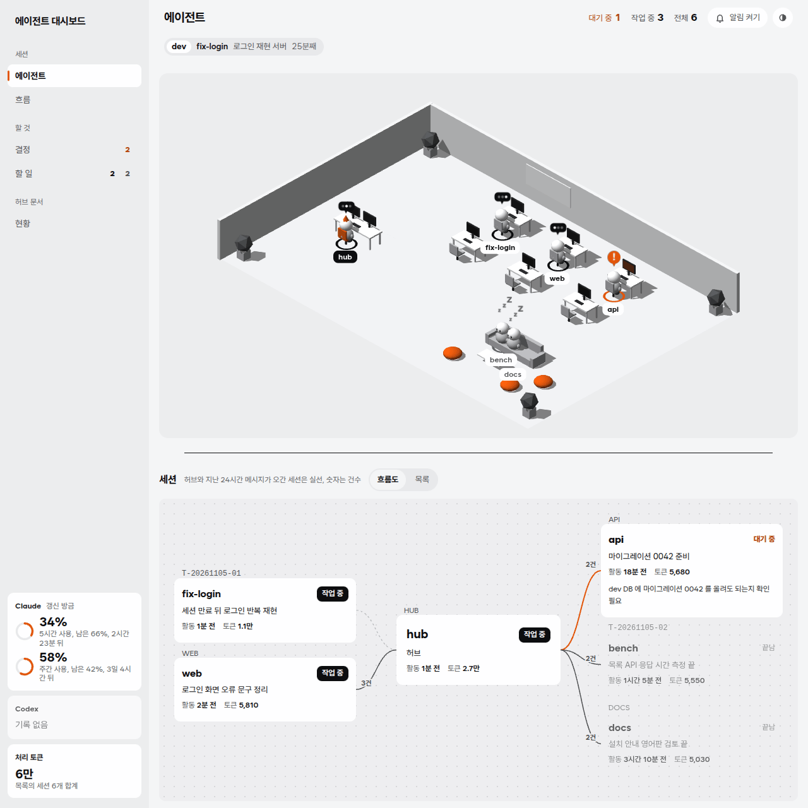
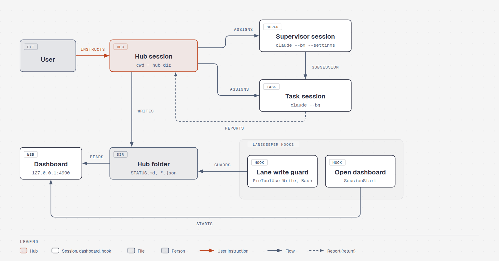
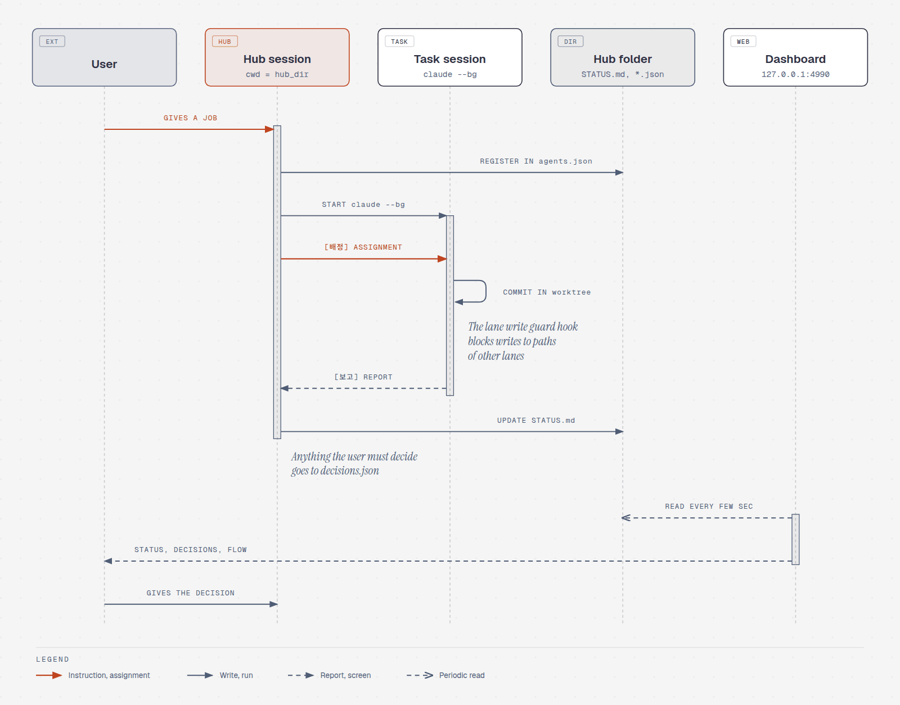
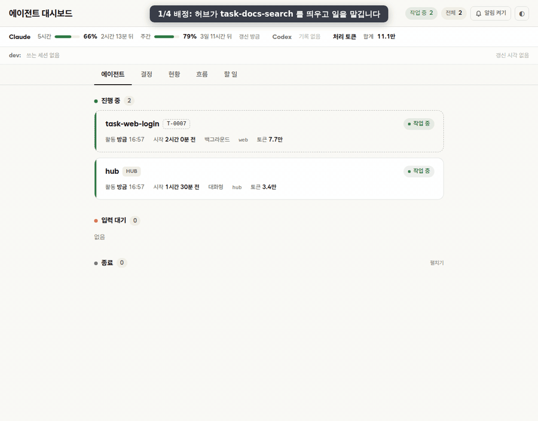
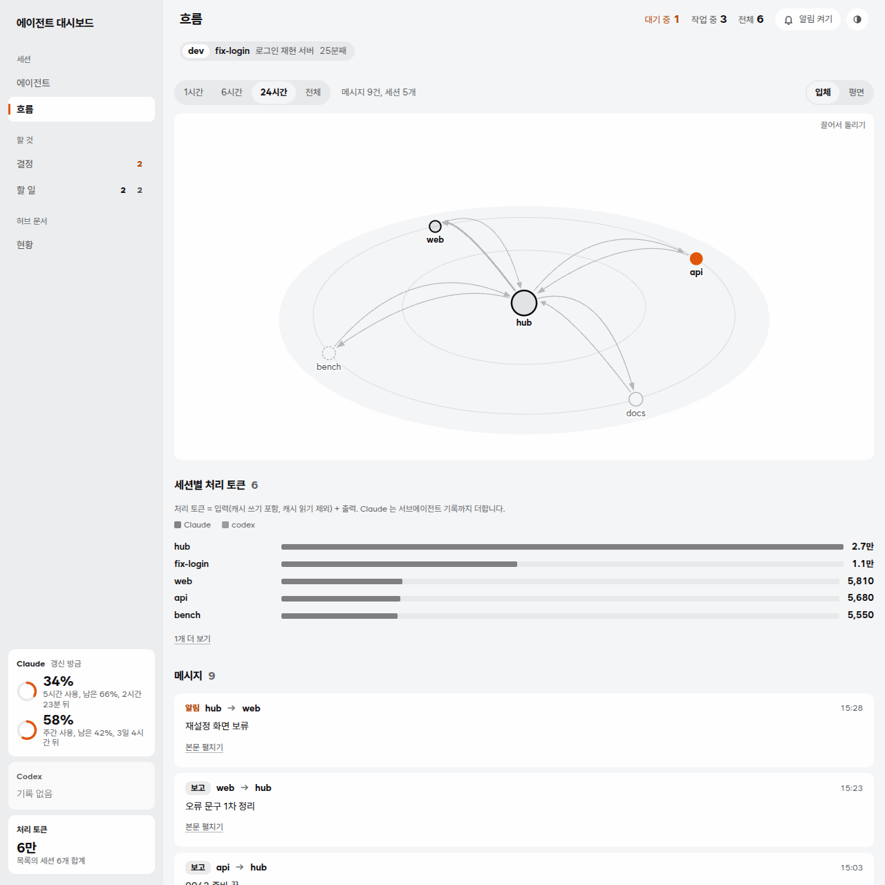

# lanekeeper

English | [한국어](README.ko.md)

A plugin that makes one Claude Code session the hub. The hub splits work across other sessions, hands it out, receives their reports and keeps the record. It ships with rule document templates for the hub, a local dashboard that shows what the sessions are doing, and a hook that keeps each session to its own lane.

<picture>
  <source media="(prefers-color-scheme: dark)" srcset="docs/images/dashboard-dark.png">
  
</picture>

<picture>
  <source media="(prefers-color-scheme: dark)" srcset="docs/images/en/architecture-dark.png">
  
</picture>

The dashboard is in Korean, so its screenshots have Korean labels.

## What is in it

| Part | Where | What it does |
|---|---|---|
| Hub rule templates | `templates/hub/` | The hub role and when to use which skill (`CLAUDE.md`), agreements between sessions and the report format (`COORDINATION.md`), a status board (`STATUS.md`) and three empty data files |
| Dashboard | `dashboard/` | A web page that only reads. It shows running sessions, user decisions, status and messages between sessions. It uses only the Python standard library |
| Hooks | `hooks/` | Start the dashboard when a session opens in the hub folder, and stop a session from writing to the hub folder or to another lane's paths |
| Skills | `skills/` | `setup` to finish the install, `update` to get a new version and bring the hub folder up to date |
| Install scripts | `scripts/` | `setup_hub.py`, called by the `setup` skill, copies the hub folder and merges settings. `update_hub.py`, called by the `update` skill, brings the hub folder up to the new templates |
| Settings examples | `examples/` | Sample settings for the hub and supervisor sessions, such as permissions and the default model |

## From assignment to report

The user talks only to the hub. The hub starts a task session and sends it an `[배정]` (assignment) message. When the task session is done it sends back a `[보고]` (report). The hub writes the result to `STATUS.md` and collects anything that needs a user decision in `decisions.json`, so the user can check it all at once on the dashboard.

<picture>
  <source media="(prefers-color-scheme: dark)" srcset="docs/images/en/flow-dark.png">
  
</picture>

## Quick start

You need Claude Code and Python 3.8 or later.
The steps are the same on Windows, Linux and macOS.

The hub rule templates (`templates/hub`) and the skill documents are written in Korean. The hub session reads them as they are, so the hub follows Korean rules and writes Korean messages unless you translate the templates.

In a terminal (PowerShell on Windows), install the plugin from the GitHub marketplace.

```sh
claude plugin install lanekeeper --marketplace holiday0726/lanekeeper
```

When the install finishes you will see a note that the settings `python` and `hub_dir` are empty.
The next step fills them in.

Open `claude` in any folder and call the setup skill.

```
/lanekeeper:setup
```

The skill goes through these steps.
Running it again gives the same result.

1. Finds Python 3.8 or later.
   On Windows it tries `py -3` first, then `python`.
   Hooks run without a shell, so on Windows the setting is the absolute path to `python.exe`.
2. Asks for the hub folder.
   The default is `hub` under your home folder.
   You can also pass it directly, as in `/lanekeeper:setup C:/Users/<you>/hub`.
3. Creates the hub folder and copies the rule templates and settings examples.
   Files that already exist are not overwritten.
4. Adds `crossSessionInbound: "accept"` to your user settings (`~/.claude/settings.json`) if it is missing (`examples/user.settings.json`).
   Other settings such as the model are left alone.
   Existing values stay, and the file is backed up to `settings.json.bak-<time>` before writing.
5. Puts the hub folder path into `agents.json`, and sets the plugin settings `python` and `hub_dir`.
6. Asks whether to install the [Addy-skills](https://github.com/holiday0726/Addy-skills) plugin if it is missing. The default is not to install it.

When the skill is done, close the session and open a new one in the hub folder.
Settings take effect only after Claude Code is opened again.

```sh
cd ~/hub
claude
```

When the session opens and shows a line starting with `대시보드 http://127.0.0.1:4990 떠 있음` (dashboard is up), open that address in a browser.
To view it from a browser on another PC, see [Viewing from another PC](#viewing-from-another-pc). The hook message points to the Korean heading of the same section, "다른 PC 에서 보기".
In the hub session, type `/rename hub`.
Then fill in the `<...>` spots as in steps 1, 2, 4, 5 and 6 of [Set up the hub folder](#set-up-the-hub-folder).

To get a new version, see [Updating](#updating).

## Updating

Call the update skill in the hub session.

```
/lanekeeper:update
```

The skill goes through these steps.

1. It gets the new version (the two commands below) and tells you the old and new version numbers. For a manual install it asks before running `git pull` in that folder.
2. It compares the hub folder with the new templates, shows what would change, and sums up the CHANGELOG since your version. This step changes nothing.
3. If you say yes, it backs up to `<hub folder>/.lanekeeper/backup-<time>/` and then makes the changes.
   - Rule documents (`CLAUDE.md`, `COORDINATION.md`) and settings (`.claude/settings.json`, `supervisor.settings.json`): your lines stay and only what changed in the templates goes in. Where you and the template changed the same place, the file is left alone and the skill suggests what to add. For settings JSON it adds only new top level keys and only shows nested changes such as new permission lines.
   - Status board, roster, decisions and dev occupancy (`STATUS.md`, `agents.json`, `decisions.json`, `dev-occupancy.json`): created only when missing, never changed.
   - User settings (`~/.claude/settings.json`): missing keys are added, as `/lanekeeper:setup` does.
4. It tells you how to undo: `update_hub.py <hub folder> --restore <backup folder>` puts the hub folder back as it was.

It compares against the template copies that `/lanekeeper:setup` or the last update left in `<hub folder>/.lanekeeper/base/`.
A hub folder made with 0.6.0 or earlier has no such copies, so the first update shows the full difference between your files and the new templates and you pick what to take. After that only template changes show up.

0.6.0 does not have this skill. The first time, get the new version in a terminal, type `/reload-plugins` in the session, and then call it.
For a marketplace added from GitHub, like this one, Claude Code's background auto-update is off by default.

```sh
claude plugin marketplace update lanekeeper
claude plugin update lanekeeper@lanekeeper
```

The new version loads when you start Claude Code again, or after `/reload-plugins` in a session that is already open.
To let Claude Code do this in the background, open `/plugin` in a session, go to **Marketplaces**, select `lanekeeper` and choose **Enable auto-update**. It then checks within ten minutes after your first message in a session and, when it gets one, shows a line saying the plugin was updated and that `/reload-plugins` applies it.

A dashboard that is already running keeps showing the old version, because the hook only starts a server when none is running. Stop it with the pid on the first line of its log (see [Dashboard](#dashboard)), then open the hub session again. From 0.5.0 the session start message says so when the running server is from another version. That message points to the Korean heading of this section, "업데이트".

The two commands above and auto-update replace only the plugin's own copy under `~/.claude/plugins/cache/`. These stay as they are:

- The hub folder: the rule documents and data files that `/lanekeeper:setup` copied, `.claude/settings.json` and `supervisor.settings.json`. Template changes in a new version go in only when you say yes in `/lanekeeper:update`.
- Your user settings (`~/.claude/settings.json`) and the plugin settings (`python`, `hub_dir` and the rest), which are stored under the plugin name.
- The dashboard logs in `~/.claude/plugins/data/lanekeeper-lanekeeper/`.

If you installed from a cloned folder ([Manual install](#manual-install)), run `git pull` in that folder instead.

## Moving from the old name

Up to 0.3.0 the plugin was called `agent-hub`. Remove it with `claude plugin uninstall agent-hub@agent-hub` and `claude plugin marketplace remove agent-hub`, install as in [Quick start](#quick-start), and run `/lanekeeper:setup <hub folder>` to enter the settings again. The hub folder stays as it is. Details are in the [CHANGELOG](CHANGELOG.md) under 0.4.0.

## Manual install

To change the code, clone the repository and add the folder as a local marketplace. Then run `/lanekeeper:setup` as in [Quick start](#quick-start); it fills in `python` and `hub_dir`.

```sh
git clone https://github.com/holiday0726/lanekeeper.git ~/lanekeeper
claude plugin marketplace add ~/lanekeeper      # Windows: C:/Users/<you>/lanekeeper
claude plugin install lanekeeper@lanekeeper
claude plugin details lanekeeper@lanekeeper     # installed if it shows Skills (2), Hooks (2)
```

The plugin reads that folder in place, so do not move it. To update, run `git pull` there and type `/reload-plugins`. For a PC without internet access, carry over `git bundle create ../lanekeeper.bundle HEAD main` and clone the bundle there.

## Addy-skills (optional)

The "스킬 쓰는 때" (when to use skills) section of the hub template `CLAUDE.md` calls skills from the [Addy-skills](https://github.com/holiday0726/Addy-skills) plugin: seven skills that oversee assignments and reports (`addy-skills:agent-oversight` and the skills under it), `humanizer` for prose, and `git-message` with an optional git message check hook. The last two lived in lanekeeper until 0.5.1. Without the plugin the hub skips that section.

```sh
claude plugin install addy-skills --marketplace holiday0726/Addy-skills
```

## Settings

`/lanekeeper:setup` fills in the first two. Change any of them with `claude plugin configure lanekeeper@lanekeeper`, or `/plugin configure lanekeeper@lanekeeper` in a session.

| Key | Required | Meaning | Default |
|---|---|---|---|
| `python` | Yes | Python 3 command that runs the hooks. `python3` on Linux and macOS, the absolute path to `python.exe` with `/` on Windows (hooks run it without a shell) | none |
| `hub_dir` | Yes | Absolute path to the hub folder. On Windows write it with `/`, as in `C:/Users/<you>/hub` | none |
| `dashboard_port` | No | Dashboard port. The address is always `127.0.0.1` | `4990` |
| `orca` | No | Whether to open the dashboard in an Orca browser tab when the hub session opens | on (only if the `orca` command exists) |
| `lane_message_hub_only` | No | Whether workers may `SendMessage` only to the hub ([Hooks](#hooks)) | off |

## Set up the hub folder

The hub folder is where you open the hub session, and it must be the same path as the `hub_dir` setting. Copy the rule templates and settings examples into it.
If you used `/lanekeeper:setup`, the copy below and steps 3 and 4 are already done.

Linux, macOS:

```sh
mkdir -p ~/hub/.claude
cp ~/lanekeeper/templates/hub/* ~/hub/
cp ~/lanekeeper/examples/hub.settings.json ~/hub/.claude/settings.json
cp ~/lanekeeper/examples/supervisor.settings.json ~/hub/supervisor.settings.json
```

Windows PowerShell:

```powershell
$hub = "C:\Users\<you>\hub"; $src = "C:\Users\<you>\lanekeeper"
New-Item -ItemType Directory -Force "$hub\.claude" | Out-Null
Copy-Item "$src\templates\hub\*" $hub
Copy-Item "$src\examples\hub.settings.json" "$hub\.claude\settings.json"
Copy-Item "$src\examples\supervisor.settings.json" "$hub\supervisor.settings.json"
```

After copying, fill them in for your project. A plugin cannot set permissions or the default model, so they come as example files.

1. `.claude/settings.json`: model and permissions of the hub session. Put the repositories the hub must not edit directly into the `<레인 저장소>` (lane repository) spot under `deny`, and their parent folders into `additionalDirectories`.
2. `supervisor.settings.json`: the file the hub attaches with `--settings` when it starts a supervisor session. Write what the supervisor is allowed to do as sentences in `autoMode.allow`.
3. Merge the keys of `examples/user.settings.json` into your user settings (`~/.claude/settings.json`, on Windows `%USERPROFILE%\.claude\settings.json`) by hand. `crossSessionInbound: "accept"` lets messages between sessions arrive without waiting for approval.
4. Put the hub folder path into `resident.hub.cwd` in `agents.json`, and match the name with `/rename hub` inside the hub session. The dashboard treats the session whose `lane` is `HUB` in this file as the hub. Under `lanes`, list the paths each lane owns, for example `"WEB": ["~/projects/web"]`. The lane write guard hook reads them. `python3 ~/lanekeeper/scripts/lane_deny.py ~/hub` prints matching `deny` lines for step 1.
5. Fill in lanes, repositories and interfaces at the `<...>` spots in `CLAUDE.md` and `COORDINATION.md`.
6. Decide two things in `CLAUDE.md`. Change the cap on task sessions running at once (8 by default) under "세션 다루기" (handling sessions) to fit your PC and plan. Merge delegation under "하지 않는 것" (what the hub does not do) is optional: delete that line if you do not use it, or write below it whether you allow it and which repositories are exceptions.

## Dashboard

Every few seconds it reads `agents.json`, `decisions.json`, `STATUS.md` and `dev-occupancy.json` in the hub folder, plus the session records under `~/.claude`, and shows them. It only reads. It does not send input to sessions or stop them.



<picture>
  <source media="(prefers-color-scheme: dark)" srcset="docs/images/dashboard-flow-dark.png">
  
</picture>

The sessions and data on screen are samples for illustration.

| Tab | What it shows |
|---|---|
| 에이전트 (Agents) | A flow chart with the hub in the middle, or a card list; click a session for its conversation and the `claude logs` screen. The `3D 오피스` (3D office) button turns on an optional isometric office above it and only then loads three.js. Each session has a desk: it sits and types while it works, shows an orange `!` when it waits for you, and walks to the lounge when it rests. Assignment and report sheets fly between the hub and the desks. Drag to turn the room, click a person to open that session. Without WebGL the office stays hidden |
| 결정 (Decisions) | Decision items from `decisions.json` and sessions waiting for user input right now |
| 현황 (Status) | `STATUS.md` |
| 흐름 (Flow) | `SendMessage` between sessions as a graph and a list. The graph is tilted 3D by default (drag or arrow keys to turn it) and can be switched to flat. The prefixes `[배정]`, `[보고]` and `[알림]` tell the kinds apart |
| 할 일 (To do) | To do list per session |

When the window is 1000px or wider, the tabs move to a sidebar on the left and the usage rings sit at its foot.

When you open a session in the hub folder, the hook starts the dashboard for you, so there is nothing else to run. To start it by hand, pass the hub folder and port as environment variables.

```sh
HUB_DIR=~/hub PORT=4990 python3 ~/lanekeeper/dashboard/server.py
```

```powershell
$env:HUB_DIR = "C:\Users\<you>\hub"; $env:PORT = "4990"; py -3 C:\Users\<you>\lanekeeper\dashboard\server.py
```

The log of a server started by the hook is at `~/.claude/plugins/data/lanekeeper-lanekeeper/dashboard-<port>.log`, and its first line has the server pid. To stop it, run `kill <pid>` (on Windows `Stop-Process -Id <pid>`). Each screen is described in [dashboard/README.md](dashboard/README.md) (Korean).

### Viewing from another PC

The dashboard listens only on `127.0.0.1`, so it opens only on the computer where Claude Code runs. To view it in a browser on another PC, it depends on your client.

- Same PC: open `http://127.0.0.1:<port>` as is.
- A client that forwards ports (VS Code or Cursor Remote, Orca): open the forwarded `http://127.0.0.1:<port>`. The dashboard answers only requests addressed to `127.0.0.1:<port>` or `localhost:<port>`, so the port on your PC must be the same number. If it is forwarded to a different number you get `bad host`.
- A client that does not forward ports, such as Paseo: keep the command below running on your PC and open `http://127.0.0.1:<port>`. The same command works in Windows PowerShell. If you changed the port, replace both 4990s with it. Your PC must be able to SSH to that host, and closing the window ends the tunnel.

  ```sh
  ssh -N -L 4990:127.0.0.1:4990 <user>@<host>
  ```

Do not bind it to `0.0.0.0` or put it behind a public tunnel service. Anyone who can reach the address can read session conversations and logs. If other accounts log in to the same PC, set the environment variable `LANEKEEPER_TOKEN` to a long random value before opening the hub session. The server then answers only to a browser that opened `http://127.0.0.1:<port>/?token=<value>` once (kept in a cookie), and the session start message shows that address.

## Hooks

`hooks/hooks.json` uses the form that does not go through a shell, so it works the same on Windows with Git Bash or PowerShell. All hook scripts are Python.

| Hook | When | What it does |
|---|---|---|
| Open dashboard (`open_dashboard.py`) | Session start (SessionStart) | Acts only when the project folder is `hub_dir` or inside it. Starts the dashboard if it is not running, and opens it in an Orca tab if `orca` is on. If the running server is from another version, it says to stop it ([Updating](#updating)) |
| Lane write guard (`lane_guard.py`) | Before Edit, Write, NotebookEdit, Bash, SendMessage | The hub folder belongs to the hub, and each path under `lanes` in the hub's `agents.json` belongs to that lane. A session may write only to its own lane, decided by the folder it was opened in (a worktree under `<repo>/.claude/worktrees/` counts as the repository). Other writes are blocked with a message to ask the hub. Windows paths with different case, backslashes or the `/c/` form count as the same path. Bash is checked on a best effort basis only: redirects (`>`, `>>`), `tee`, `sed -i`, `cp`, `mv`. Variables, scripts and other commands get through, so this catches mistakes and is not a security boundary. With `lane_message_hub_only` on, workers may `SendMessage` only to the hub |

## Skills

| Skill | How to call | Use |
|---|---|---|
| setup | `/lanekeeper:setup [hub folder]` | Finishes the install. Creates the hub folder and fills in user settings and plugin settings. See [Quick start](#quick-start) |
| update | `/lanekeeper:update [hub folder]` | Gets a new version and brings the hub folder up to the new templates. It previews first and backs up before it changes anything. See [Updating](#updating) |

## Repository layout

```
.claude-plugin/   plugin.json, marketplace.json
dashboard/        server.py, index.html, app.css, js/, test_server.py, vendor/
docs/             README images (images/en, images/ko) and their sources (diagrams/en, diagrams/ko)
examples/         hub.settings.json, supervisor.settings.json, user.settings.json
hooks/            hooks.json, open_dashboard.py, lane_guard.py, hubpath.py
scripts/          setup_hub.py, update_hub.py, lane_deny.py
skills/           setup/, update/
templates/hub/    CLAUDE.md, COORDINATION.md, STATUS.md, agents.json, decisions.json, dev-occupancy.json
tests/            tests for the hooks and the install and update scripts
```

## Running the tests

```sh
python3 -m pip install pytest
python3 -m pytest -q                    # hooks, install and update scripts, dashboard server (tests/, dashboard/)
claude plugin validate --strict .       # manifest check
```

On Windows use `py -3` in place of `python3`. The hook tests run under the same conditions as a Korean Windows locale (standard I/O default cp949). GitHub Actions runs the same tests on Linux and Windows for every push ([.github/workflows/test.yml](.github/workflows/test.yml)).

## License and credits

MIT license ([LICENSE](LICENSE)). Bundled parts follow their own licenses.

- `dashboard/vendor/three.min.js`, `OrbitControls.js`: [three.js](https://github.com/mrdoob/three.js) r128 (npm 0.128.0, unchanged), MIT, `dashboard/vendor/three-LICENSE`
- `dashboard/vendor/xterm.js`, `xterm.css`: [xterm.js](https://github.com/xtermjs/xterm.js) 5.5.0, MIT, `dashboard/vendor/xterm-LICENSE`
- `dashboard/vendor/WantedSansVariable.woff2`: [Wanted Sans](https://github.com/wanteddev/wanted-sans) 1.0.3, SIL OFL 1.1, `dashboard/vendor/WantedSans-OFL.txt`

Both README diagrams were drawn with diagram-design. The sources for each language are in `docs/diagrams/en/` and `docs/diagrams/ko/`.
